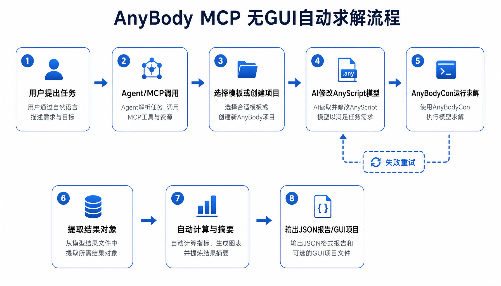

# MCP-for-anybody

`MCP-for-anybody` lets an AI agent use `AnyBody Modeling System` without opening the GUI.



It can:

- create a local AnyBody project copy
- run `AnyBodyCon.exe`
- extract result objects
- calculate simple summaries such as bilateral knee reaction forces

This repository is a **first working version** focused on local Windows usage.

## Who this is for

If you are new to MCP or AnyBody, start here.

You do **not** need to understand the full codebase to try it.

## What is included

- `src/anybody_mcp_server.py`: MCP server
- `src/anybody_runner.py`: local AnyBody automation helpers
- `scripts/run_no_gui_workflow.py`: no-GUI gait example
- `scripts/run_new_posture_workflow.py`: no-GUI new-posture example
- `start-anybody-mcp.bat`: one-click local server launcher
- `mcp-config.anybody.json`: example MCP client config
- `anybody-mcp-workflow.png`: workflow diagram

## Requirements

This version assumes:

1. Windows
2. AnyBody is installed locally
3. `AnyBodyCon.exe` exists at:
   - `C:\Program Files\AnyBody Technology\AnyBody.7.3\AnyBodyCon.exe`

## Quick Start

### 1. Start the MCP server

Double-click:

- `start-anybody-mcp.bat`

Or run:

```powershell
D:\Python projects\anybody-automation\start-anybody-mcp.bat
```

### 2. Add this server to your MCP client

Use the example config in:

- `mcp-config.anybody.json`

Its core content is:

```json
{
  "mcpServers": {
    "anybody": {
      "command": "D:\\Python projects\\anybody-automation\\.venv\\Scripts\\python.exe",
      "args": [
        "D:\\Python projects\\anybody-automation\\src\\anybody_mcp_server.py"
      ]
    }
  }
}
```

### 3. First test

After your MCP client connects, call:

- `get_installation_info`

If that works, the server is connected correctly.

## Easiest demo

The simplest no-GUI demo is the gait workflow.

Run:

```powershell
D:\Python projects\anybody-automation\.venv\Scripts\python.exe "D:\Python projects\anybody-automation\scripts\run_no_gui_workflow.py" --project-dir "D:\Python projects\anybody-automation\workspace\auto-gait-run" --overwrite
```

This will:

1. create a local gait project
2. run it with `AnyBodyCon`
3. extract left/right knee reaction forces
4. write a JSON report

Expected report:

- `workspace\auto-gait-run\Output\knee-force-summary.json`

## New posture demo

You can also test a new posture without GUI.

Example:

```powershell
D:\Python projects\anybody-automation\.venv\Scripts\python.exe "D:\Python projects\anybody-automation\scripts\run_new_posture_workflow.py" --project-dir "D:\Python projects\anybody-automation\workspace\auto-posture-run" --preset "forward-lean" --overwrite
```

Current built-in posture presets:

- `forward-lean`
- `mild-squat`
- `staggered-stance`

## Main MCP tools

Useful beginner tools:

- `get_installation_info`
- `create_named_project`
- `run_model`
- `get_model_object_value_after_operation`
- `summarize_bilateral_knee_forces`
- `run_no_gui_gait_knee_force_workflow`
- `run_no_gui_new_posture_workflow`

## Successful GUI-openable example

If you still want a reference project for manual inspection in AnyBody GUI, use:

- `workspace\gui-gait-demo\GaitVaughan.main.any`

Saved output file:

- `workspace\gui-gait-demo\Output\GaitVaughan.main.anydata.h5`

## Files for advanced users

If you want more implementation details, see:

- `DELIVERY.md`
- `src/anybody_runner.py`
- `src/anybody_mcp_server.py`

## Current scope

This first version is best at:

- running existing AnyBody examples without GUI
- creating simple new quasi-static postures
- extracting result objects automatically

It is **not yet** a full automatic solver for every brand-new complex motion.

## Workflow Diagram

See:

- `anybody-mcp-workflow.png`
